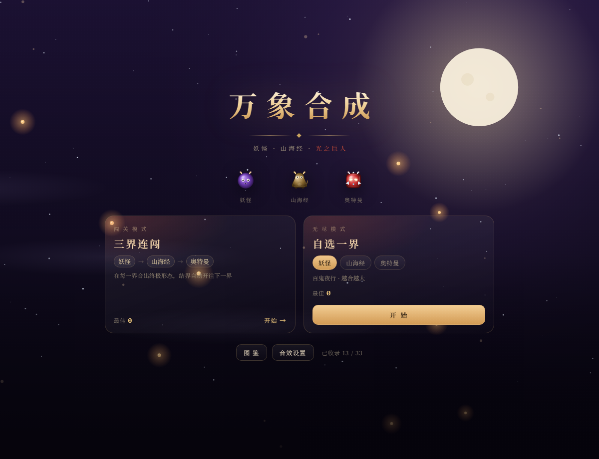
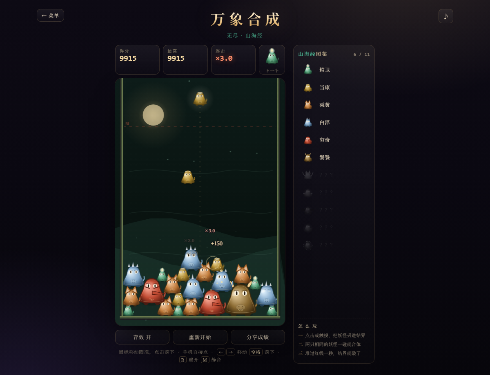

# 万象合成 · 妖怪 / 山海经 / 光之巨人

一个单文件网页小游戏：把相同的角色叠在一起合成更大的，三种主题、两种模式、四首现场合成的配乐。

**打开方式**： https://Muyi-Z.github.io/wanxiang-merge/ 不用安装任何东西，断网也能玩。

---

## 两种模式

**闯关模式 · 三界连闯**
妖怪 → 山海经 → 奥特曼，依次闯三界。在每一界合出该界的**终极形态**（百鬼夜行 / 混沌 / 传说之光），结界就会开启，自动进入下一界。三界全部通关 → 「三界归一」结算。

**无尽模式 · 自选一界**
先选一个主题，然后一直合下去，堆满结界为止。三个主题的最高分分别记录。

---

## 三种主题，三种完全不同的长相

| 界 | 身体形状 | 特征 | 11 阶 |
|---|---|---|---|
| 妖怪 | 圆球 | 獠牙、腮红、耳朵 | 提灯小妖 → 河童 → 狐妖 → 雪女 → 天狗 → 酒吞童子 → 九尾狐 → 雷神 → 大天狗 → 八岐大蛇 → **百鬼夜行** |
| 山海经 | 小头大身的兽形（像蹲坐的青铜兽） | 竖瞳、青铜眉、兽吻、小尾巴 | 精卫 → 当康 → 乘黄 → 白泽 → 穷奇 → 饕餮 → 夔牛 → 烛龙 → 应龙 → 鲲鹏 → **混沌** |
| 奥特曼 | 装甲圆角方 + 肩甲 | 发光眼、头冠、胸口计时器 | 光之种 → 初代 → 赛文 → 杰克 → 艾斯 → 泰罗 → 迪迦 → 赛罗 → 奥特之父 → 奥特之王 → **传说之光** |

奥特曼的胸口计时器在结界快满时会从蓝变红。三套背景也不一样：夜樱月亮 / 墨绿金乌山影 / 深蓝星空光环行星。

---

## 图鉴

主菜单 →「图 鉴」，三个主题各 11 只，共 33 只。

- 没合出来过的：只有黑色剪影 + `？？？`
- 合出来过的：点亮，显示名字，卡片带金边
- **三界分别记录**，进度存在这台设备上
- 游戏里右侧的图鉴也会跟着点亮

---

## 操作

| 操作 | 说明 |
|---|---|
| 鼠标移动 | 瞄准落点 |
| 点击 | 落下一个 |
| **按住左键** | **连续下落**，松手即停 |
| 触摸 | 点一下落一个 |
| ← → | 微调落点 |
| 空格 / 回车 | 落下 |
| R | 重新开始 |
| M | 静音 |
| ♪（右上角） | 背景音乐开关 |

规则：两只**完全相同**的角色碰到一起就会合成，变成大一阶的新角色。连续合成有连击倍率（最高 ×3）。堆过红色警戒线并停留 1 秒，结界就破了。

---

## 背景音乐

全部是浏览器**现场合成**的（振荡器 + 噪声 + 压缩器），没有音频文件，所以还是单文件。

四首曲子各有鼓组、贝斯、旋律和铺底：

| 曲目 | 速度 | 乐器与感觉 |
|---|---|---|
| 主菜单 | 112 BPM | 底鼓+军鼓+踩镲，锯齿贝斯，昂起来的主题旋律 |
| 妖怪 | 98 BPM | 太鼓 + 轻快笛声，和风祭典 |
| 山海经 | 76 BPM | 大鼓 + 长音铺底，远古、厚重 |
| 奥特曼 | 132 BPM | 四拍底鼓 + 锯齿主音，明亮、英雄感 |

开关：主菜单「音效设置」最上面一行，或游戏界面右上角的 ♪。设置会保存。

---

## 音效

三种合成音色可试听可选：**清音 / 泡泡 / 太鼓**。

**等级越高，声音越猛**：音量、时长、层次都会往上叠 ——
5 阶以上加低频冲击，7 阶以上加闪光三连音，9 阶以上加长尾。合出越大的家伙，响声越夸张。

---

## 发布 / 分享给朋友

**最省事：直接发文件** —— 把 `index.html` 发微信 / QQ，对方保存后双击就能玩。

**最通用：做成网址发链接**（手机点开就能玩）：

### 方式一：Netlify Drop（推荐，1 分钟，不用注册也能先试）

1. 打开 <https://app.netlify.com/drop>
2. 把整个 `yokai-merge` 文件夹拖进网页
3. 等几秒，得到一个 `https://xxxx.netlify.app` 的网址
4. 注册一个免费账号可以永久保留这个网址

### 方式二：GitHub Pages

1. 新建仓库（Public）
2. 上传 `index.html`（必须放在仓库**根目录**）
3. 仓库 Settings → Pages → Source 选 `main` / `root` → Save
4. 一两分钟后访问 `https://用户名.github.io/仓库名/`

> ⚠️ 注意：`github.io` 在国内网络下经常打不开或很慢。**代码放 GitHub 没问题，但发给朋友的链接建议用 Netlify**。

### 方式三：Gitee Pages（国内速度快）

1. <https://gitee.com> 新建仓库并上传 `index.html`
2. 仓库 → 服务 → Gitee Pages
3. 需要完成实名认证才能开启

游戏里的「分享成绩」会把成绩复制到剪贴板。

---

## 想改点什么

用记事本或 VS Code 打开 `index.html`，搜索关键词：

| 想改的内容 | 搜什么 | 说明 |
|---|---|---|
| 角色名字 | `tiers: [` | 每个主题 11 行，`art` 决定它长什么样 |
| 颜色 | `pal: [` | 每个主题 11 组颜色：亮色 / 主色 / 描边 |
| 身体形状 | `function bodyPath` | 三种主题的轮廓都在这里改 |
| 音乐旋律 | `const TRACKS` | `bpm` 速度、`root` 音高、`mel` 旋律、`drums` 鼓点（`k` 底鼓 `s` 军鼓 `h` 踩镲 `t` 太鼓） |
| 音乐音量 | `MUSIC.bus.gain.value = 0.62` | 嫌吵就调到 0.45 |
| 出场概率 | `const SPAWN_W = [` | 只出前 4 阶，数字是权重 |
| 合成得分 | `const MERGE_SCORE` | 合出第 N 阶得多少分 |
| 下落速度 | `const G = 3900` | 数字越大掉得越快越硬 |
| 警戒线 | `const LINE = 136` | 越小越难 |

---

## 隐藏参数（加在网址后面）

- `?mode=campaign` —— 直接进闯关模式
- `?mode=endless&theme=shanhai` —— 直接进无尽模式的指定主题（yokai / shanhai / ultra）
- `?stage=1` —— 直接跳到第二界
- `?screen=codex` —— 直接打开图鉴
- `?sim=900` —— 快进模拟 900 帧，用来快速看满盘效果
- `?w=390` —— 把页面锁成手机宽度，方便在电脑上检查手机布局

---

## 更新记录

**v4**
1. 菜单背景音乐重做成有鼓点的主题曲，三界各一首专属配乐（太鼓 / 大鼓 / 快节奏英雄风）
2. 菜单加了动态场景：星空、月亮、飘浮灯笼、光点，标题加装饰线
3. 新增独立图鉴页：33 只，未解锁显示 `？？？` 剪影
4. 合成音效随等级变强：5 阶加低频、7 阶加闪光、9 阶加长尾
5. 三界棋盘里加了各自主色的浮动光点

**v3**
1. 加背景音乐（初版）
2. 修复游戏内「← 菜单」点不动
3. 三套主题改成三种身体形状
4. 按住左键连续下落

**v2**
1. 重力 2200 → 3900，出手冷却 0.24s → 0.12s，落地压缩回弹
2. 三种主题、33 个角色
3. 主菜单 + 闯关/无尽两种模式
4. 三种合成音效

---

*用 AI 做游戏的关键不是一次说清所有需求，而是「先要一个能跑的版本，再一轮一轮提意见」。*
